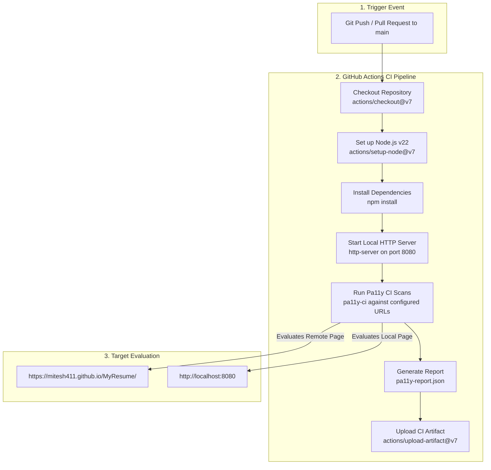

# AXEDemo

[](https://github.com/Mitesh411/AXEDemo/actions/workflows/blank.yml)

AXEDemo is a repository demonstrating automated web accessibility testing using **[pa11y-ci](https://github.com/pa11y/pa11y-ci)**. It evaluates remote URLs and local web components against WCAG standards to ensure web interfaces are inclusive and accessible to all users.

---

## Table of Contents

- [Overview](#overview)
- [Architecture & Workflow Diagram](#architecture--workflow-diagram)
- [Features](#features)
- [Prerequisites](#prerequisites)
- [Installation](#installation)
- [Usage](#usage)
- [Configuration](#configuration)
- [Continuous Integration (CI/CD)](#continuous-integration-cicd)
- [Troubleshooting & Testing](#troubleshooting--testing)
- [License](#license)

---

## Overview

Accessibility testing ensures web applications are usable by everyone, including people with visual, motor, auditory, or cognitive impairments. `AXEDemo` integrates `pa11y-ci` into a headless Puppeteer environment to continuously scan target web pages against `WCAG2AA` guidelines, generating detailed JSON reports and failing CI builds when critical issues are detected.

---

## Architecture & Workflow Diagram

The diagram below illustrates the local development and CI/CD workflow pipeline:



---

## Features

- **Automated Accessibility Testing:** Executes automated headless browser checks on target URLs.
- **WCAG 2.0 AA Compliance:** Evaluates web pages against strict `WCAG2AA` standards by default.
- **CI/CD Integration:** Runs automatically on push and pull requests to the `main` branch via GitHub Actions.
- **Artifact Exporting:** Generates and publishes structured `pa11y-report.json` artifacts for audit trails.
- **Customizable Rule Engine:** Easy configuration for ignoring specific non-blocking rules or false positives.

---

## Prerequisites

Ensure you have the following installed on your environment:

- **Node.js:** `>=22.0.0`
- **npm:** Package manager included with Node.js.

---

## Installation

Clone the repository and install dependencies:

```bash
# Clone repository
git clone https://github.com/Mitesh411/AXEDemo.git

# Navigate into project directory
cd AXEDemo

# Install dependencies
npm install
```

---

## Usage

### Local Testing

1. **Start the local server** (if evaluating local files):
   ```bash
   npm run start
   ```
   *This starts `http-server` serving the current directory on port `8080` without caching.*

2. **Run Accessibility Scans:**
   ```bash
   npm run a11y
   ```
   *Executes `pa11y-ci` against configured URLs.*

3. **Export JSON Report Locally:**
   ```bash
   npm run a11y -- --json > pa11y-report.json
   ```

---

## Configuration

Accessibility rules, launch arguments, and target URLs are managed in `.pa11yci`.

```json
{
  "defaults": {
    "standard": "WCAG2AA",
    "timeout": 30000,
    "wait": 1000,
    "ignore": [
      "WCAG2AA.Principle3.Guideline3_1.3_1_1.H57.2",
      "WCAG2AA.Principle2.Guideline2_4.2_4_2.H25.1.NoTitleEl"
    ],
    "chromeLaunchConfig": {
      "args": [
        "--no-sandbox",
        "--disable-setuid-sandbox"
      ]
    }
  },
  "urls": [
    "https://mitesh411.github.io/MyResume/"
  ]
}
```

### Key Parameters:
- **`standard`**: Accessibility standard to test against (`WCAG2AA`, `WCAG2A`, `WCAG2AAA`).
- **`timeout`**: Maximum execution time per URL (in milliseconds).
- **`chromeLaunchConfig`**: Arguments passed to Puppeteer/Chromium (e.g. `--no-sandbox` required in CI environments).
- **`urls`**: Array of remote URLs or local endpoints to evaluate.

---

## Continuous Integration (CI/CD)

The GitHub Actions workflow defined in `.github/workflows/blank.yml` uses the latest stable GitHub Actions:

- **`actions/checkout@v7`**: Checks out repository code.
- **`actions/setup-node@v7`**: Sets up Node.js v22 environment.
- **`actions/upload-artifact@v7`**: Uploads `pa11y-report.json` as a build artifact.

---

## Troubleshooting & Testing

If Chromium fails to launch in Docker or CI environments, ensure `--no-sandbox` is specified under `chromeLaunchConfig` in `.pa11yci`.

To verify your changes locally before submitting pull requests:
```bash
npm run a11y
```
